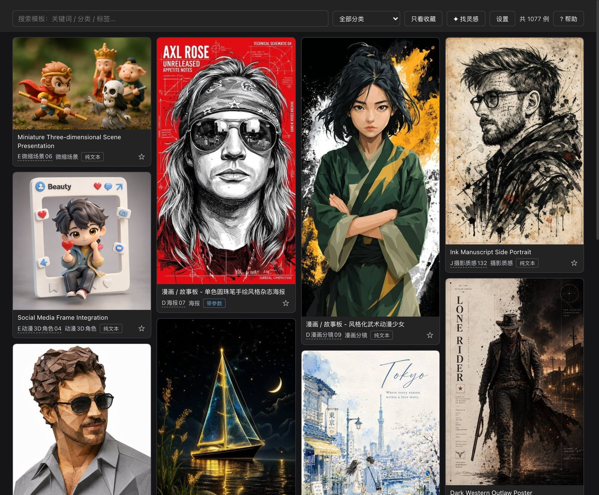
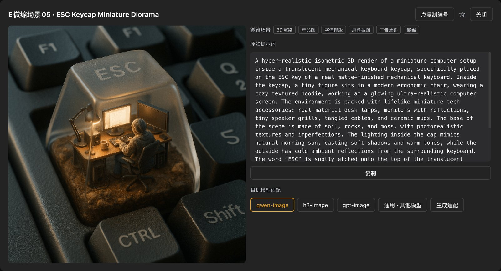
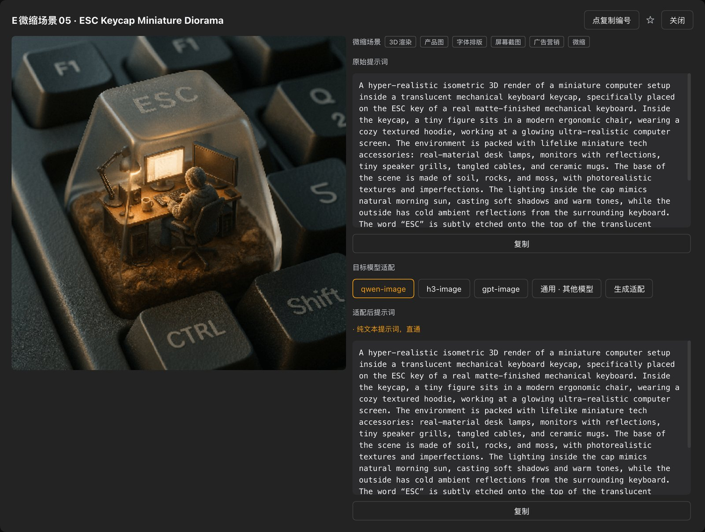

# dsh-prompt-wall

[简体中文](#简体中文) | [English](#english)

## 简体中文

> **非官方声明**：本插件是社区独立开发的第三方工具，与 OpenAI、Google 或任何模型厂商无关联、未获背书；文中出现的 GPT、ChatGPT、Nano Banana 等名称均归其商标持有人所有。

一个 [DeepSeek Harness](https://github.com/deepseek-ai/deepseek-harness)（DSH）插件：把 1077 条社区生图提示词模板做成侧栏里的**选片墙**——缩略图瀑布流、搜索、收藏，配两个 agent 工具（`prompt_wall` 检索、`prompt_wall_adapt` 按目标模型出适配提示词）。面板负责挑，聊天负责出图：点开一张模板，复制编号贴进对话说"用这个生图"，agent 取提示词、按你的生图模型改好格式再跑管线。



### 你会得到什么

- **卡片墙**——瀑布流布局，缩略图按原图比例显示不裁切；顶栏吸顶，滚到 1077 条的哪里都够得着搜索和筛选。
- **搜索与筛选**——关键词跨编号/标题/标签/分类，分类下拉，只看收藏开关。
- **收藏**——点 ☆ 收藏，存在本机，不出机器。
- **灵感模式**——一键随机抽 24 张，再点换一批；打开面板默认显示什么（全部/随机/收藏优先）在设置里选。
- **单模板详情**——宽屏两栏：左边大图，右边提示词正文、标签和适配入口；点图放大看细节。




- **提示词适配**——选目标模型点"生成适配"，拿到可直接提交的提示词（见下节）。
- **agent 工具**——`prompt_wall`（search/get/categories/favorites）与 `prompt_wall_adapt`（按目标模型归一化）。
- **可分享的提示词**——复制出的提示词在任何生图工具里都能用，发给问"这图怎么做的"的朋友，对方不需要装任何东西。

### 提示词适配

上游模板有三种形态：纯文本、`{argument}` 占位符、结构化 JSON 规格。把 JSON 规格原样喂给文本渲染型模型会画成一堵文字墙，所以 `prompt_wall_adapt` 按目标归一化：

| 目标 | 行为 |
|---|---|
| `qwen-image`、`h3-image`、通用 | 从 JSON 规格里提取画面描述，`{argument}` 槽填默认值或你给的值 |
| `gpt-image` | 结构化 JSON 规格原样保留 |



### 数据与许可

`data/entries.json`——1077 条，汇编自九个公开上游仓库。每条带来源库、分类、标签、提示词形态和缩略图；缩略图是上游示例图缩小后的预览。

**许可**：插件代码是 MIT（见 `LICENSE`）。提示词数据和缩略图**不是** MIT——它们各自保留上游许可（MIT / Apache-2.0 / CC BY 4.0 / CC0 / 按仓库署名要求），逐源条款和署名文本在 [`UPSTREAMS.md`](UPSTREAMS.md) 与 [`licenses/upstream/`](licenses/upstream/)。有一个上游（lib2）声称 MIT 但 LICENSE 文件 404，其条目未随本仓库分发。

### 安装（DSH）

需要 DSH ≥ 0.2.0。把仓库链接进 profile：

```
git clone https://github.com/aiohow/dsh-prompt-wall.git
ln -s "$(pwd)/dsh-prompt-wall" ~/.dsh/profiles/<profile>/plugins/dsh-prompt-wall
```

重启 DSH（或重载 profile）加载插件。

### 开发

```
node smoke-host.mjs     # 宿主：路由、工具、适配、分页、设置
node smoke-client.mjs   # 客户端：假 React 渲染、墙、收藏、帮助
```

两个脚本成功时打印 `*_SMOKE_OK`。用户数据（收藏、设置）在 `~/.dsh/prompt-wall/`，永不入库。

### 免责

模板是社区收集的提示词，质量和适配度由你自己判断，插件对生成结果不作任何保证。预览缩略图由上游示例输出缩放而来，不代表你生出来的图长这样。

---

## English

> **Unofficial**: an independent community project, not affiliated with or endorsed by OpenAI, Google, or any model vendor. GPT, ChatGPT, Nano Banana and other names are trademarks of their respective owners.

A [DeepSeek Harness](https://github.com/deepseek-ai/deepseek-harness) (DSH) plugin: 1077 community image-generation prompt templates as a **prompt wall** in the sidebar — thumbnail waterfall, search, favorites — plus two agent tools (`prompt_wall` for retrieval, `prompt_wall_adapt` for per-model prompt adaptation). The panel is the picker, the chat does the generating: open a template, click its code, paste it into the conversation and say "make an image with this" — the agent fetches the prompt, reshapes it for your image model and runs your pipeline.


### What you get

- **Card wall** — masonry layout, native image ratios (no cropping), sticky top bar that stays reachable while you scroll all 1077 entries.
- **Search & filter** — keyword search across code/title/tags/category, category dropdown, favorites-only toggle.
- **Favorites** — star anything; stored locally, never leaves the machine.
- **Inspire** — one click draws 24 random templates, click again for a new batch; choose the default view (everything / random / favorites first) in Settings.
- **Template detail** — two-column layout on wide screens: image on the left, prompt text, tags and adaptation entry on the right; click the image to zoom.


- **Prompt adaptation** — pick a target model, hit adapt, get a prompt ready to submit (see below).
- **Agent tools** — `prompt_wall` (search/get/categories/favorites) and `prompt_wall_adapt` (normalize a template for a target model).
- **Shareable prompts** — a copied prompt works in any image tool; send it to the friend who asks "how was this made?". No plugin needed on their side.

### Prompt adaptation

Templates come in three shapes: plain text, `{argument}` placeholders, and structured JSON specs. Feeding a raw JSON spec to a text-rendering model draws a wall of text, so `prompt_wall_adapt` normalizes per target:

| Target | Behavior |
|---|---|
| `qwen-image`, `h3-image`, generic | extracts the scene description from JSON specs, fills `{argument}` slots with defaults or your values |
| `gpt-image` | keeps structured JSON specs intact |


### Data

`data/entries.json` — 1077 entries compiled from nine public upstream repositories. Each entry carries its source `lib`, category, tags, prompt shape, and thumbnail. Thumbnails are downscaled previews of the upstream example images.

**Licensing**: the plugin code is MIT (see `LICENSE`). The prompt data and thumbnails are **not** MIT — they remain under their respective upstream licenses (MIT / Apache-2.0 / CC BY 4.0 / CC0 / per-repo attribution). See [`UPSTREAMS.md`](UPSTREAMS.md) and [`licenses/upstream/`](licenses/upstream/) for the per-source terms and attribution notices. One upstream (lib2) claims MIT but its LICENSE file 404s, so its entries are not distributed here.

### Install

Requires DSH ≥ 0.2.0. Link a checkout into your profile:

```
git clone https://github.com/aiohow/dsh-prompt-wall.git
ln -s "$(pwd)/dsh-prompt-wall" ~/.dsh/profiles/<profile>/plugins/dsh-prompt-wall
```

Restart DSH (or reload the profile) to load the plugin.

### Development

```
node smoke-host.mjs     # host: routes, tools, adaptation, paging, settings
node smoke-client.mjs   # client: fake-React render, wall, favorites, help
```

Both print `*_SMOKE_OK` on success. User data (favorites, settings) lives in `~/.dsh/prompt-wall/` and is never committed.

### Disclaimer

The templates are community-collected prompts; their quality and suitability for your model are your call. This plugin makes no warranty about generation results. Preview thumbnails are resized from upstream example outputs and do not represent the appearance of your generated images.
